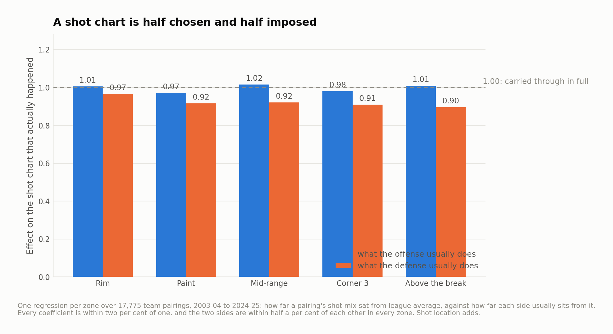
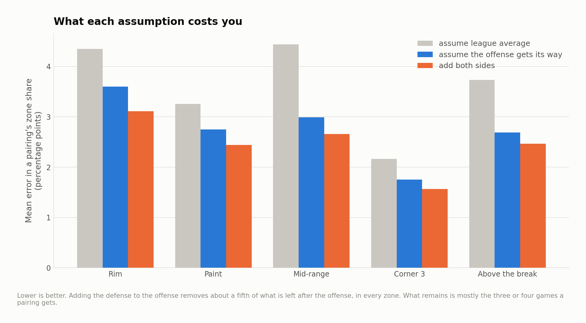
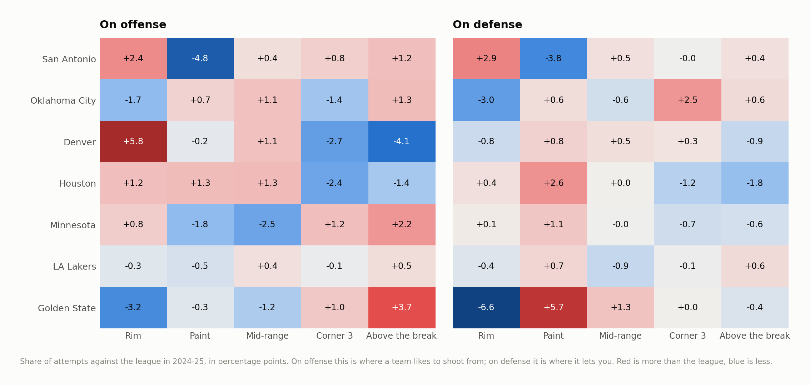
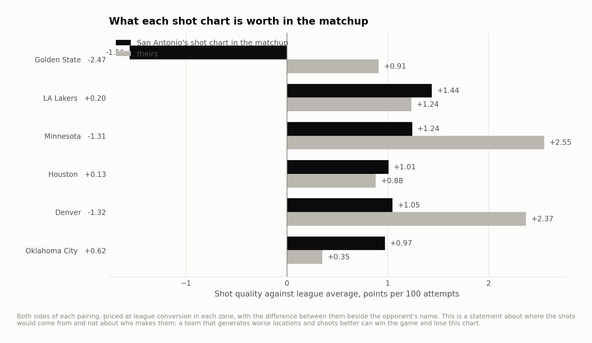

# A matchup atlas for the Western top tier

San Antonio and Oklahoma City met in the 2026 Western Conference finals and it
went seven. This is a scouting instrument built on the last full season the
public shot mirror covers, 2024-25, and it starts by asking whether the
instrument works at all.

Twenty-two seasons, 17,775 team pairings, 4.4 million attempts, 2003-04 to
2024-25.

**A shot chart is half chosen and half imposed, the two halves add, and there is
no matchup effect on top of them.**

---

## The question underneath every scouting report

The natural way to guess what a game will look like is to add: start from the
league, add what this offense usually does, add what that defense usually does.
Everyone does this implicitly. Almost nobody checks it.

It is checkable. Every pairing has an actual shot chart, and both sides have a
season profile built from **the rest of their games** — the pairing's own three
or four are taken out, because predicting them from a season average that
contains them is partly predicting them from themselves. That leakage is worth
four points of R², which is more than anything else tested here.



| Zone | Offense | Defense | R² | Interaction adds |
|---|---|---|---|---|
| Rim | 1.005 | 0.965 | 0.482 | +0.0006 |
| Paint | 0.971 | 0.917 | 0.427 | +0.0007 |
| Mid-range | 1.016 | 0.921 | 0.636 | +0.0015 |
| Corner 3 | 0.980 | 0.910 | 0.463 | +0.0054 |
| Above the break | 1.009 | 0.897 | 0.555 | +0.0006 |

Three things fall out of that table.

**Both sides carry.** Every coefficient is close to one. A team that shoots four
percentage points more at the rim than the league does so against everyone, and a
defense that concedes four points more at the rim concedes them to everyone.

**The offense carries slightly more.** The offensive coefficients average 0.996
and the defensive ones 0.922. It is a small asymmetry and it is consistent across
all five zones: an offense takes a little more of its identity into a game than
a defense does.

**There is no matchup effect.** Adding the product of the two deviations — the
term that would fire if a rim-heavy offense meeting a rim-denying defense ended
up somewhere other than the sum — moves R² by six ten-thousandths in four zones
out of five. The one exception, the corner three, gains five thousandths.

So the atlas is arithmetic. That is a boring answer and it is worth having,
because it says a matchup report needs two profiles and a plus sign, not a model.

---

## What the arithmetic buys



Mean error in a pairing's zone share, in percentage points:

| Zone | Assume league | Assume the offense gets its way | Add both sides |
|---|---|---|---|
| Rim | 4.35 | 3.60 | **3.11** |
| Paint | 3.25 | 2.75 | **2.44** |
| Mid-range | 4.44 | 2.99 | **2.66** |
| Corner 3 | 2.16 | 1.75 | **1.57** |
| Above the break | 3.73 | 2.69 | **2.47** |

Knowing the offense removes about a quarter of the error. Adding the defense
removes about a seventh of what is left. What remains is mostly the three or four
games.

**Conversion is a different story.** Run the identical test on whether the shots
went in and the coefficients still come out sensible — 0.85 for the offense, 0.81
for the defense — but the R² is 0.19. That is not the model failing. At 227
attempts, **roughly 84% of the variance in a pairing's field goal percentage is
the sample size**, on a binomial approximation that if anything understates the
noise. There is nothing to predict at this resolution.

Which is why everything below prices shot *location* at league conversion and
says nothing about who makes them.

---

## The Western tier, 2024-25



Six teams and a rising one, in percentage points of shot share against the
league. A few things stand out before any matchup is computed. Denver takes 5.8
points more of its shots at the rim than anyone in the league and 4.1 points
fewer above the break, which is one player. Golden State's defense is the most
distinctive in the group by a distance: 6.6 points fewer at the rim and 5.7 more
in the paint outside it. Oklahoma City's defense gives up corner threes, 2.5
points above league, to buy 3.0 points off the rim.

And San Antonio takes 4.8 points fewer of its shots in the paint outside the rim
than the league — the most extreme number on the offensive side of the chart.

---

## What each defense does to San Antonio


| Defense | Rim | Paint | Mid | Corner 3 | Above break | Worth |
|---|---|---|---|---|---|---|
| Golden State | **−6.6** | **+5.7** | +1.3 | +0.0 | −0.5 | **−3.04** |
| Oklahoma City | −3.0 | +0.6 | −0.6 | +2.5 | +0.6 | −0.50 |
| Houston | +0.4 | +2.6 | +0.0 | −1.2 | −1.8 | −0.47 |
| Denver | −0.8 | +0.8 | +0.5 | +0.3 | −0.9 | −0.43 |
| Minnesota | +0.1 | +1.1 | −0.0 | −0.7 | −0.6 | −0.23 |
| LA Lakers | −0.4 | +0.8 | −0.9 | −0.1 | +0.6 | −0.04 |

*(Percentage points of shot share moved, and the whole change in points per 100
attempts.)*

Golden State is three times the problem anybody else in the group is, and it is
not close. They push six and a half points of San Antonio's attempts off the rim
and into the least valuable two-point zone on the floor. Oklahoma City's defense
does something quite different: it takes the rim away too, but it pays for it in
corner threes, and against a team that likes corner threes that is close to an
even trade.

---

## Both directions



| | San Antonio's shot chart | Theirs | Difference |
|---|---|---|---|
| Oklahoma City | +0.97 | +0.35 | **+0.62** |
| Houston | +1.01 | +0.88 | +0.13 |
| LA Lakers | +1.44 | +1.24 | +0.20 |
| Minnesota | +1.24 | +2.55 | −1.31 |
| Denver | +1.05 | +2.37 | −1.32 |
| Golden State | −1.56 | +0.91 | **−2.47** |

*(Points per 100 attempts against league average.)*

On shot selection alone, and with every caveat below attached, the best matchup
in this group is Oklahoma City and the worst by a distance is Golden State.

That is a narrow claim about a narrow thing. It says nothing about who wins. The
2024-25 Thunder gave up an ordinary shot chart and then held everyone under
league conversion in every zone on the floor, which is the subject of the sibling
`okc-defence` repository and is not in this one.

---

## What this does not do

- **No conversion.** Everything is priced at league rates in each zone, because
  a pairing cannot measure conversion. A team that generates worse shots and
  makes more of them wins the game and loses this chart.
- **No free throws, no turnovers, no possessions.** A shot file has none of them.
  The attempt side of a matchup — who gets more shots — is the subject of
  `okc-defence` and is deliberately not folded in here.
- **A season profile is not a playoff profile.** Rotations shorten, coverages
  change, and the best player plays forty minutes. The additive result is
  established on regular-season pairings and there is no reason to assume the
  coefficients survive into May.
- **The subject season is 2024-25**, which is where the mirror ends, and San
  Antonio's roster is not what it was.

---

## Running it

```bash
pip install -r requirements.txt
python src/run_01_build.py      # 22 season files -> season and pairwise profiles
python src/run_02_matchups.py   # the additivity test and the atlas, figures 01-05
```

Or `make all`. Under two minutes once the raw files are on disk.

```
src/
  config.py        paths, seasons, the teams the atlas covers
  matchup.py       the additive model, the leave-one-out split, the tests
  labels.py        collision-resolving point labels
  style.py         one place that decides what every figure looks like
  run_0*.py        the pipeline, in order
output/            every number quoted above, as CSV
figures/           five figures, regenerated from scratch by the pipeline
docs/method.md     longer notes, including why the interaction test is the point
```

## Data

Shot-level data from
[DomSamangy/NBA_Shots_04_24](https://github.com/DomSamangy/NBA_Shots_04_24), a
mirror of the league's public shot chart endpoint. `data/README.md` has the fetch
step and the sample-size constraint the whole project works inside.

## License

MIT. See `LICENSE`.
